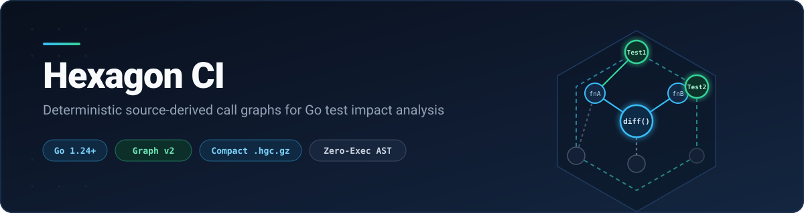
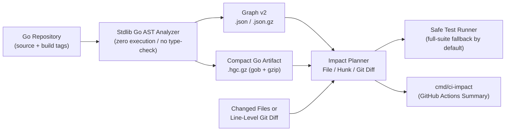

<div align="center">



# Hexagon CI

**Deterministic source-derived call graphs for Go test impact analysis.**

[](https://github.com/aayushhzz/hexagon-ci/actions/workflows/ci.yml)


[Architecture](#-architecture) · [Quick Start](#-quick-start-cli) · [Go Library API](#-go-library-api) · [GitHub Actions](#-github-actions-diagnostics) · [Formats & Safety](#-graph-formats--safety-model) · [Benchmarks](#-testing--benchmarks)

</div>

---

Hexagon CI is a Go CLI and reusable Go library (`github.com/aayushhzz/hexagon-ci/hexagon`) that builds per-test source call graphs from Go ASTs without executing or type-checking repository code, maps file or line-level diffs to potentially affected test roots, and runs Go tests with a safe full-suite fallback.

JSON graphs retain the **graph v2** contract; a compact Go-specific `.hgc.gz` artifact is also available for large repositories. The earlier Python implementation and its parity tests are preserved under [`python/`](python/) as a runnable reference.

---

## Architecture



---

## Quick Start (CLI)

Build the CLI and generate a repository call graph:

```sh
go build -o /tmp/hexagon-ci .

# JSON Graph v2
/tmp/hexagon-ci graph /path/to/go/repository --output /path/to/graph.json

# Gzipped JSON Graph v2 with explicit Go build tags
/tmp/hexagon-ci graph /path/to/go/repository --go-tags alt --output /path/to/graph.json.gz

# Compact Go-specific artifact (.hgc.gz)
/tmp/hexagon-ci graph /path/to/go/repository --output /path/to/graph.hgc.gz
```

The original positional invocation remains supported:

```sh
/tmp/hexagon-ci /path/to/go/repository --language go --output /path/to/graph.json
```

### Generate an Impact Plan & Run Tests

Pass the current graph, changed repository-relative paths, and (when available) the previous graph so deleted files still contribute candidates:

```sh
/tmp/hexagon-ci plan /path/to/graph.json \
  --changed-file lib/config.go \
  --previous-graph /path/to/base-graph.json \
  --output /path/to/plan.json

/tmp/hexagon-ci test /path/to/go/repository --plan /path/to/plan.json
```

`plan` accepts either JSON Graph v2 or `.hgc.gz` for both the current and previous snapshots without expanding every compact test view.

---

## Go Library API

The reusable Go API lives in `github.com/aayushhzz/hexagon-ci/hexagon`; the root CLI delegates directly to this package.

### File-Level Impact Planning

```go
import "github.com/aayushhzz/hexagon-ci/hexagon"

func plan(repository string, changedFiles []string, previous *hexagon.Graph) (*hexagon.ImpactPlan, error) {
	graph, err := hexagon.BuildGraph(repository, nil)
	if err != nil {
		return nil, err
	}
	return hexagon.PlanFileChanges(graph, changedFiles, previous)
}
```

### Function & Line-Level Diff Planning

- **`PlanDiff` / `PlanCompactDiff`** — accept parsed structured hunks, return the standard `ImpactPlan`, map changed lines to functions, walk reverse caller edges to test roots, and preserve the full-suite fallback whenever mapping or graph completeness is uncertain. Raw unified-diff parsing stays outside the library.
- **`PlanGitDiff` / `PlanGitDiffCompact`** — accept old/new paths with 1-based inclusive changed-line ranges and return a `FunctionDiffPlan` containing `TestRoots` and `FunctionsToRun` (the trace of changed functions, callers, and test roots). Unmappable ranges, missing base graphs, and unresolved calls set `RunFullSuite` and broaden candidate roots to every current test.

```go
plan, err := hexagon.PlanGitDiff(headGraph, gitDiff, baseGraph)
if err != nil {
	return err
}
if plan.RunFullSuite {
	// Keep the safe full-suite fallback; the candidate roots remain diagnostic.
}
for _, testRoot := range plan.TestRoots {
	// Each value is a graph function ID such as "pkg/service_test.go::TestUpdate".
	_ = testRoot
}
```

### Compact Graph Helpers & Diagnostic Runner

- `BuildCompactGraph`, `RebuildCompactToFile`, `ReadCompactGraph`, and `NewCompactIndex(...).TestGraph(root)` build, read, and lazily expand single test views from `.hgc.gz` artifacts.
- `RunCandidateTests` provides an explicit diagnostic execution path; ordinary `RunTests` continues to honor the full-suite safety flag.

---

## GitHub Actions Diagnostics

For CI experiments, [`cmd/ci-impact`](cmd/ci-impact/main.go) accepts head and base repository checkouts plus a zero-context unified diff. It builds both graphs, maps the diff, runs the candidate test roots with `go test -count=1 -v`, and writes the candidate count, total head-graph test roots, selection reason, and selected root names to `$GITHUB_STEP_SUMMARY`.

```sh
go run ./cmd/ci-impact \
  --repository "$GITHUB_WORKSPACE" \
  --base-repository "$RUNNER_TEMP/base" \
  --diff "$RUNNER_TEMP/change.diff" \
  --summary "$GITHUB_STEP_SUMMARY"
```

> **Note:** The candidate run is diagnostic. Keep your repository's full-suite CI job as the correctness baseline.

---

## Graph Formats & Safety Model

| Format | Extension | Contents | Best For |
| --- | --- | --- | --- |
| **JSON Graph v2** | `.json`, `.json.gz` | Function nodes, resolved call edges, per-test subgraphs, unresolved calls, package/import metadata, source fingerprints, build context | Cross-language tooling, inspection, Python parity |
| **Compact Go Graph** | `.hgc.gz` | Versioned, gzip-compressed `gob` artifact storing function names once and test reachability as sorted function IDs | Large Go monorepos, lower memory & disk footprint |

### Safety Invariants

- **Conservative full-suite fallback:** The planner reports call-graph and package-import candidates, sets `run_full_suite: true`, and leaves `selection_complete` unset. Static AST analysis cannot prove that callbacks, interface dispatch, function values, generated code, external modules, `init()` side effects, or runtime config have no effect on other tests.
- **Strict runner verification:** `test` runs `go test ./...` unless a plan explicitly marks selection complete **and** its source fingerprint, analyzer, and Go build context still match the checkout. Incomplete, stale, or mismatched plans fall back to the full suite.
- **Explicit build context:** Build tags from graph analysis carry into test execution; Go environment flags are rejected unless expressed via `--go-tags`.
- **Integrity & atomicity:** Graph writes are atomic, gzip output is deterministic, parse/source-change failures leave previous outputs intact, and readers reject unsupported graph or plan versions.

---

## Repository Layout

| Path | Description |
| --- | --- |
| [`main.go`](main.go) | Root CLI entrypoint (`graph`, `plan`, `test`) |
| [`hexagon/`](hexagon/) | Reusable Go library: AST analyzer, graph v2, compact `.hgc.gz`, file/diff planners, runner |
| [`cmd/ci-impact/`](cmd/ci-impact/) | GitHub Actions diagnostic diff-to-test runner and step-summary reporter |
| [`benchmarks/compactgraph/`](benchmarks/compactgraph/) | Compact vs. JSON graph benchmark harness |
| [`python/`](python/) | Archived Python reference (`test_call_graph`, `graph_v2_reference`, and unit tests) |
| [`docs/`](docs/) | Benchmark measurements and sanity audits |

---

## Testing & Benchmarks

### Go Suite & Static Checks

```sh
go test ./...
go vet ./...
```

The Go integration tests execute the Python reference against shared Go fixtures to verify graph v2 and selector parity.

### Archived Python Reference

```sh
PYTHONPATH=python python3 -m test_call_graph /path/to/repository --language go --output /tmp/python-graph.json
PYTHONPATH=python python3 -m unittest discover -s python/tests -v
PYTHONPATH=python/graph_v2_reference python3 -m unittest discover -s python/graph_v2_reference/tests -v
```

### Benchmark Reports

- [Prometheus Go Benchmark & Sanity Audit](docs/prometheus-go-benchmark.md) — observed edges, deterministic rebuilds, and concrete missed-dependency cases
- [Go / Python Monolith Graph Benchmarks](docs/go-monolith-graph-benchmarks.md) — build-time comparisons
- [Compact Go Graph Implementation Measurements](docs/compact-go-graph-implementation.md) — artifact size, memory, and planning costs
- [Compact Go Graph Benchmark](docs/compact-go-graph-benchmark.md) — benchmark methodology and results
