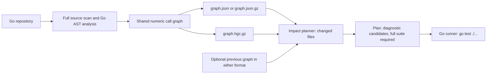
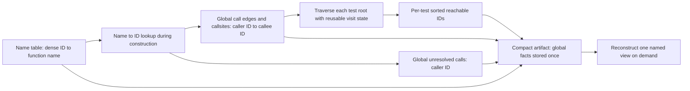

# Production graph storage follow-up (2026-10-10)

The earlier [compact-format experiment](compact-go-graph-benchmark.md) avoided repeating function names and global call facts per test, but still constructed every named test view before conversion. The implementation now prepares the global numeric graph once, traverses it directly for either graph-v2 or compact output, and stores each compact test as a **sorted list of reachable function IDs**. The existing JSON graph-v2 contract remains the default; a `.hgc.gz` output selects the compact Go-specific format. The planner reads either format, including mixed base/head pairs, without expanding compact test views. The graph-v2 writer streams one test at a time to avoid an additional full-graph JSON buffer.

## Architecture and pipeline



The CLI chooses the compact writer only when the output ends in `.hgc.gz`; JSON graph v2 remains the default. Both builders recheck the repository sources before publishing an atomic snapshot. The planner reads either format for the current and previous graph so deleted-file evidence is retained. Its plan remains version 1 with `run_full_suite=true`; the runner therefore executes all Go tests. The existing GitHub Actions workflow tests the implementation but does not build or consume compact graph artifacts automatically.



Function IDs are positions in the name-sorted node table. They are deterministic for one snapshot but can shift when functions are added or removed, so current and previous snapshots are compared through function names and file metadata rather than assuming stable numeric IDs. The production format uses sparse `uint32` lists, not the fixed bitsets in the earlier experiment. This is an in-process representation and a smaller persisted artifact, not a cross-run cache: each graph command still scans and analyzes the repository. The compact file has a versioned magic header, gzip and Go `gob`; it retains build context and fingerprints and validates its structure on read. JSON remains the interoperable output.

## Measurements and parity

| Pinned repository | Tests | Graph-v2 gzip / compact bytes | Build v2 / compact (single run) | Load v2 / compact (median of 3) | 300 named views v2 / compact (median of 3) |
| --- | ---: | ---: | ---: | ---: | ---: |
| [Prometheus](https://github.com/prometheus/prometheus) `2213c3c192574b8a339acd336ea6385974a7567b` | 2,074 | 11,638,252 / 924,597 | 3.03 / 0.94 s | 1,519 / 31 ms | 41 / 46 ms |
| [Grafana](https://github.com/grafana/grafana) `df53a3d5f66602b584c4dbfae012608d34f35a21` | 9,986 | 68,474,212 / 4,632,703 | 20.32 / 6.20 s | 11,324 / 155 ms | 117 / 125 ms |
| [Kubernetes](https://github.com/kubernetes/kubernetes) `a5081d965140b4ee8311bea358f1afd79b840677` | 12,735 | 40,197,265 / 8,042,138 | 23.10 / 14.04 s | 5,982 / 278 ms | 226 / 234 ms |

The query sample cycles through the first, middle, last, and largest-reachability test roots. For every repository, both formats encoded the same total JSON bytes over 300 named-view lookups: 33,457,875, 96,010,125, and 193,419,000 bytes respectively. A complete `reflect.DeepEqual` of each compact artifact expanded to graph v2 against an independently rebuilt graph-v2 artifact passed for **all 24,795 test views**, including global metadata, nodes, edges, callsites, unresolved calls, source fingerprints, and build context. The small view-reconstruction cost is outweighed by faster loading when the artifact is read for a planning operation.

For one changed-file plan per repository, the graph-v2 and compact planners wrote **byte-identical plan JSON**, retained `run_full_suite=true`, and selected 1,112, 8,270, and 176 diagnostic candidates. Serial one-run wall time and peak process RSS were:

| Repository / changed file | Plan from v2 | Plan from compact | Peak RSS v2 / compact |
| --- | ---: | ---: | ---: |
| Prometheus `tsdb/head.go` | 2.15 s | 0.04 s | 494 / 31 MB |
| Grafana `pkg/setting/setting.go` | 9.96 s | 0.19 s | 2,972 / 196 MB |
| Kubernetes `pkg/kubelet/kubelet.go` | 5.97 s | 0.32 s | 1,834 / 369 MB |

The per-test IDs are sparse on these repositories. Keeping fixed bitsets would reserve approximately 2.54, 65.00, and 179.67 MB of membership bytes before encoding; sorted `uint32` lists use approximately 0.54, 2.29, and 1.46 MB. This is why the production representation differs from the earlier benchmark prototype. Peak build RSS in the single paired runs above was **316 / 314 MB** for Prometheus, **1,681 / 1,405 MB** for Grafana, and **2,753 / 2,737 MB** for Kubernetes (v2 / compact). Go AST parsing and the source-fact decoder still dominate peak build memory, so compact storage does not guarantee a large build-RSS gain. The original benchmark's full-buffer graph-v2 writer peaked at roughly 1,093 MB, 2,843 MB, and 4,063 MB, but those are separate runs on an earlier implementation.

These measurements used an Apple Silicon Mac with 12 logical CPUs and 16 GiB RAM, Go 1.24.3, default `darwin/arm64` analysis, serial builds, `/usr/bin/time -lp` for RSS, and a prebuilt benchmark binary. Clone and compilation time are excluded. Build and plan numbers are single local runs; read and query numbers are medians of three separate processes. Warm caches, GC, and machine load can shift the values. The comparison is about artifact representation and planner loading, not correctness of the underlying static call analysis or cold CI/S3 transfer time.

Reproduce from the repository root after checking out the pinned target revision:

```sh
go build -o /tmp/compactgraph ./benchmarks/compactgraph
go build -o /tmp/hexagon-ci .
/tmp/compactgraph -mode build-v2 -repo /path/to/repo -file /tmp/graph-v2.json.gz
/tmp/compactgraph -mode build-direct-compact -repo /path/to/repo -file /tmp/graph.hgc.gz
/tmp/compactgraph -mode validate-direct -named /tmp/graph-v2.json.gz -compact /tmp/graph.hgc.gz
/tmp/compactgraph -mode read-v2 -file /tmp/graph-v2.json.gz -queries 300
/tmp/compactgraph -mode read-direct-compact -file /tmp/graph.hgc.gz -queries 300
/tmp/hexagon-ci plan /tmp/graph.hgc.gz --changed-file path/to/changed.go --output /tmp/plan.json
```

The compact file has a format-version magic header followed by gzip and Go `gob`. Reads validate the version, IDs, test membership, and compressed stream; writes use a synchronized temporary file and atomic replacement. It is a Go-specific, versioned application format rather than a stable cross-language or arbitrary Go-version wire contract. Use graph-v2 JSON export for external consumers. As before, the planner cannot establish complete static dependency coverage, so the full-suite fallback is unchanged.
